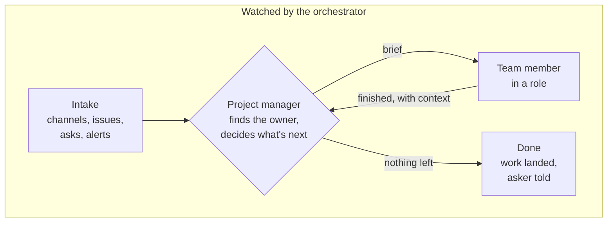

# Architecture

cuebeat runs a small team of agents the way a small human team works:
requests come in, each piece goes to the right person, people do their part
and report back, and someone keeps the whole team running. Every part is
either an agent started from a brief or a small service, so any agent
harness and any organization can use it.

The name has two parts: the **cue** is the start, the signal that sets a
piece of work going; the **beat** is the rhythm that keeps the team going.

## The core loop

- The orchestrator watches the team and keeps it running. It can take any
  issue itself, triage it and hand it to the lead for that area; on a
  problem it starts a fix or sends it to triage.
- The project manager, an agent or a lead within its area, picks the
  owner, writes the brief and says where the result goes.
- A team member works from its role's skills in its own run folder and
  reports back where its brief says.
- Decisions only a person can make leave the loop through the reach hook
  and come back as answers.

## The parts

| Part | What it does |
| --- | --- |
| Intake | Scheduled jobs that each turn one channel (issues, chat, alerts) into queue items |
| Queue and tick loop | The queue holds work; the tick loop runs on a steady beat, starts due jobs and hands queued items to the dispatcher |
| Dispatcher | Starts a worker in its own terminal session with a brief and a run folder, on any agent harness (Claude Code, Codex or another) |
| Orchestrator | A service of its own that watches the tick loop and the team, fixes what breaks and queues what needs a decision |
| Reaching a person | One hook; each workspace wires the channels it uses (chat, email, a phone call, a push notification) |
| Roles | Optional role files that group existing skills; a role can lead its area |
| Context and skills | The same context for every harness; skills found by search when they are needed |
| Run folders | Each task's brief, status and evidence |

## Why it holds up

- Any harness: each part is a run started from a brief and a run folder,
  and parts hand work to each other through files and commands.
- Any organization: names come from the workspace's own identity, and
  one organization's policy lives in its workspace settings.
- No single point of failure for intake: each intake job does one job.
  The orchestrator runs as its own service, so it can repair the tick loop
  it watches.

## Limits

- Built for a small team: a few machines, a handful of workers at once,
  plain files.
- Machine room is a limit; a full machine refuses new workers.
- One direction: the orchestrator watches the tick loop; only the
  operating system watches the orchestrator.
- A larger organization needs other trade-offs, such as many teams,
  permissions per team and a shared queue service.

## Later

- The tick loop also watching the orchestrator, and a check from another
  machine.
- Workers spread across machines on a private network.
- Readers for chat and monitoring channels; one shared project manager.
