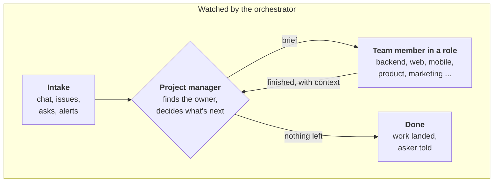
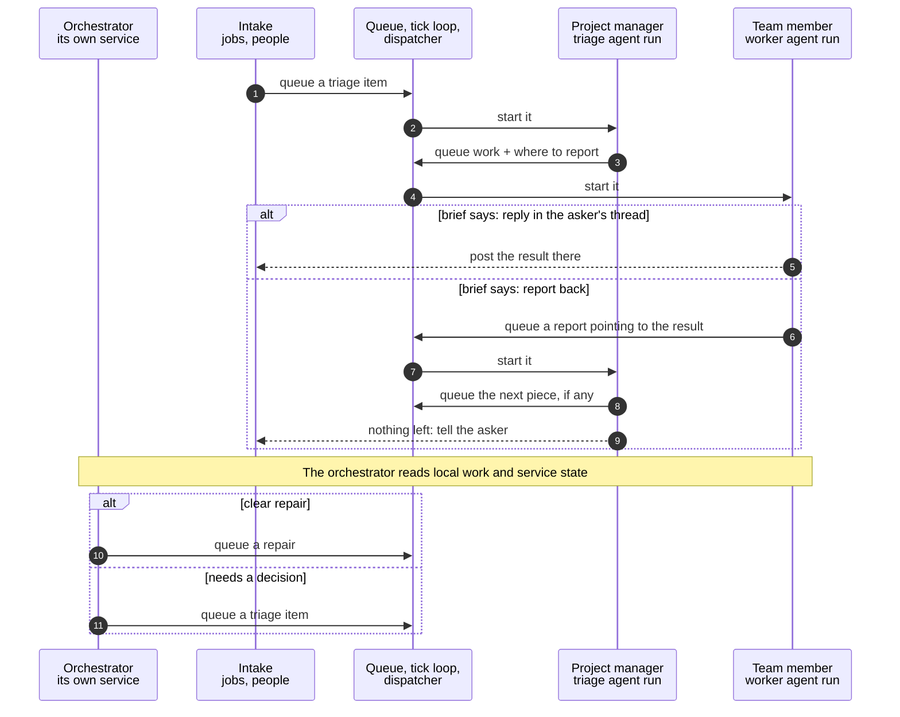
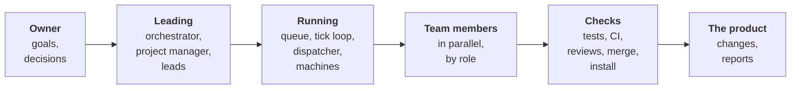
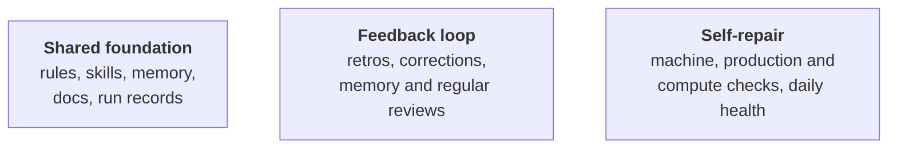

# Architecture

The idea: an agent team that works the way a human team does. A project
manager takes in asks from every channel, finds the right owner for each
piece and starts the work. Each team member works on its piece from its
role's responsibility, skills and resources, in its own task workspace, then
reports back to the project manager with what it found; the project manager
decides the next step. The orchestrator watches the whole team: when
something goes wrong, it starts an agent to fix it or sends it to the project
manager. Any agent application (Claude Code, Codex or another; we call it
a harness) can play any role, mixed in one team, and any organization
can run it with its own context and skills.

The name has two parts: the **cue** is the start, the signal that sets a
piece of work going; the **beat** is the rhythm that keeps the team going.

## The core loop

- The project manager owns routing: it picks the owner, writes the brief and
  starts the work. Clear work can skip it.
- Each team member reports back when it finishes, where its brief says,
  including work it found for another role (a mobile worker finds backend
  work); the project manager decides what comes next.
- The orchestrator watches all of this. On a problem it queues a repair,
  or sends it to the project manager to triage (decide whether work is
  needed and who owns it).
- The orchestrator's job also includes taking any issue itself, triaging
  it, and handing it to the lead or manager for that area, who hands out
  the pieces within its scope. Today's service covers the local tick loop
  and the team's existing work, described below; reading new channels is
  a planned extension.
- Decisions only a person can make are sent through one hook with a
  place to reply; bringing the answer back into the loop is a later step.

A pipeline ends. A team keeps going: a finished piece becomes the next
decision, a found problem becomes the next piece, and the watcher restarts
a stalled loop and sends the rest for a decision. The loop is what lets
the team run overnight without a person driving it.

For example: an issue reader queues a bug report; the project manager
assigns the fix to a backend worker with a brief that says to report
back; the worker returns its change and test evidence; the project
manager checks the result and tells the requester. If the worker dies,
the orchestrator sends the unfinished work back for a decision.

## The core loop, step by step

Who plays each part, in order.

### The rules that keep work moving

These are the team's operating rules, put into each task before work
starts; the tools record failures and missed returns, and the project
manager or a person still takes the next step.

- **Where the result goes is decided before the work starts.** Every
  brief names where its result goes: a reply in the asker's thread, or a
  report queued back to whoever triages. The place is lasting (a task, a
  source, a thread), not a process that may have ended by then. The worker
  follows the brief with the same queue and run folders everything else
  uses; no extra machinery.
- **What a report carries.** Its owning task, its evidence, where it
  goes, and the next decision needed. Finished, blocked and failed work
  all report the same way, so a failure is a decision to make, not a
  silence. One reporting route per piece, so an automatic return and a
  worker-written report never create two decisions.
- **Every item has an end.** Each item says when it is done, from the
  start. The round count lives in the owning task, so a fresh project
  manager run does not reset it. At the limit (three rounds to start), the
  next step is to reassess, and to ask the owner when the decision is
  theirs; not to try again.
- **Who decides what.** The project manager, or the lead for an area,
  owns each item: its owner, its next step, its end. The orchestrator owns
  the team: what runs, what died, idle capacity; it starts work by queuing
  it, and the one thing it does directly is restart the tick loop,
  because a broken tick loop cannot drain its own queue. Without that
  line, both can start the same work, or each can leave it to the other.
- **Decisions stay small.** A decision on a report starts from the brief,
  the report and its links, as a small run with a budget (a limit on
  tokens or running time, where the runtime supports it), and fetches
  fresh evidence only when it needs to. Filter routine inputs with fixed
  rules before a model runs, and measure the cost per decision before
  increasing intake. In our own system, a full agent triage per issue was
  what made that intake too expensive to keep on.
- **Fresh facts before acting.** A decision made from an old plan
  produces confident, wrong work. Read the agreed goal and constraints,
  then check the current state before acting; if new evidence
  contradicts the plan, record the mismatch and revisit the decision.
- **The orchestrator's choice on a problem.** Queue a repair for a
  failing scheduled job. Send a worker that died to triage once the
  queue's own recovery no longer owns it, so someone checks what ran
  before deciding whether to retry. Send everything that needs a choice
  of owner or priority to the project manager.

## The parts

| Part | What it is |
| --- | --- |
| Work queue | Holds work items. Each item carries its body (usually a brief), its source (which intake or person made it), its state (pending, working, done, blocked, failed; done means handed off, and the task record tracks the outcome) and an optional problem key, so a repeat from the same source joins the active item. Among eligible items, non-scheduled work normally goes first, then older work; reserved capacity and recovery work can change the order. |
| Tick loop | The scheduling service: the beat. At a set interval, 30 seconds by default, it runs due scheduled jobs and hands pending queue items to the dispatcher, up to the machine's worker limit, with some slots kept for scheduled work. The operating system restarts it after an exit; it notices when it has been replaced by a newer version and exits for the replacement; the orchestrator catches the case where it stays alive but stops making progress. It records each completed pass, which is what lets the orchestrator tell a working loop from a quiet or stuck one. |
| Scheduled jobs | Jobs the tick loop runs on a schedule. Intake jobs live here: one job per channel, each turning new issues, alerts or messages into queue items by a fixed rule (one triage item per new issue, one investigation per new kind of error). Maintenance lives here too. People and agents add items directly. |
| Dispatcher | Starts a worker: it makes the run folder, writes the brief into it, and starts the agent in the directory it is given, on the harness the run asks for. It checks the machine has room (CPU, memory, disk, free worker slots) before starting, knows whether the worker is still running, waits for it or stops it, and records whether cleanup was confirmed. A clean exit is not an accepted result; the team still checks the work. One dispatcher serves the supported harnesses (Claude Code and Codex today); adding one means adding an adapter. |
| Project manager | A triage agent run per item, or a lead within its area. It reads the item fresh, decides whether there is work, a question to ask, or nothing to do, and queues the work with its owner and where the result goes. Its decisions are small runs with a budget, not open-ended investigations. |
| Team member | A worker agent run. Its role comes from its brief and from the skills and rules of the scope it works in; optional role files group existing skills into a named role. It works in the directory it is given and its own run folder, and reports back where its brief says. |
| Orchestrator | A service of its own, beside the tick loop. It reads the team's state (the tick loop's passes, the queue, running workers, scheduled jobs, blocked items, undelivered results), restarts a stuck tick loop, and queues one repair or one triage item per problem. It uses a model only when a decision needs one. Detail below. |
| Reaching a person | One hook. A service or agent hands it a message; the hook passes it to whatever channels the organization has wired up and records what each accepted. Detail below. |
| Run folders | Every task's brief, status, progress, summary, notes and evidence, in one folder a person or another agent can read later, so a task survives a worker that dies, a context window that fills, or a hand-off to someone else. |
| Context and skills | Context is scoped: declared at each level where something is true, and composed for wherever an agent starts, once, for every harness. Skills live in the scope that owns their subject and are found by search when they are needed. Detail below. |
| Memory | Facts about how the system works, kept where agents can read and search them, with a scheduled review that proposes cleanups. Private detail stays local. |
| Checkouts | Give each change its own checkout, so file edits do not collide and a finished change is easy to review and remove; shared services, databases and outside systems still need coordination. |

## The whole system

Around the whole team:

Every agent reads the shared foundation; the feedback loop turns lessons
into improvements; self-repair keeps the machines, the product and the
compute usable without a person watching.

Where each part lives: the organization's goals, plan and roles in its own
docs; the work engine (queue, tick loop, dispatcher, orchestrator) in the
tool itself; rules, skills, memory and run records in the organization's
own scopes; checks in each repository; feedback and self-repair in
whatever routines the organization schedules.

## Any harness, any organization

Strengths of the design:

- **Any agent harness, mixed in one team.** Every agent role, project
  manager or team member, is a run the dispatcher starts from a brief and
  a run folder; roles hand off through files and commands, so they are
  independent of the agent application that runs them. The dispatcher
  starts the supported applications (Claude Code and Codex today), picks
  one per run by quota left or as asked, and adding another needs an
  adapter, not a new design. The orchestrator service is ordinary code
  that runs apart and queues agent work when needed.
- **Context and skills per organization.** An agent starts with context:
  what this place is, how to work here, which rules apply, which skills
  exist. The design is scoped: a scope is an area where a set of
  instructions applies (an organization, a project, or part of one);
  shared guidance has one editable source; context is assembled from the
  sources selected for that scope, with local information added where
  needed. Today a scope is represented as a folder with a context
  manifest. The organization's workspace holds rules and shared guidance
  written once; any scope below names them as sources, so the source is
  never copied (the generated output can go stale, and a check reports
  when it does). A repository adds what it is and how to change it; a
  folder inside it adds its own context for work there; this machine adds
  a local overlay that is never committed. The composed context is
  generated once for every harness (most harnesses read instructions from
  a file at the root of where they start but disagree on the file, so one
  is written and the others are links). Skills live in the scope that owns their subject and are found
  by search at the moment they are needed, so an agent loads only the
  skill it needs. Sync regenerates scopes when it succeeds and reports
  skips and failures.
- **Any way to reach a person.** When the team needs a person (a restart
  cap reached, a decision only the owner can make, a question a worker
  cannot answer), it hands one message to one hook: what happened and how
  urgent, the text with links to the evidence, a key for the problem so
  repeats are recognized, and whether an answer is wanted and where. Each
  organization wires the channels it uses (a chat channel, email, a phone
  call, a push notification); the tool names no channel. Each connector
  runs with its own time limit and its own recorded result, so a hanging
  one does not block the others; success means the connector accepted the
  message, not that a person read it; repeats of the same problem are
  quieted for an hour unless urgency rises; a known failure may be
  retried without resending what succeeded; a delivery with no
  acknowledgement is kept visible rather than resent, because resending
  could duplicate it. With none wired, the message is kept where the
  owner can read it, shown in status, and the result says nobody was
  reached. The system never pretends a person was told. The hook is the
  shared way to reach a person, and other notification paths use it when
  configured to, so there is one place to wire a channel, one record of
  what was sent, and one quiet rule.
- **Any organization can use it.** An organization is a workspace with its
  own identity, settings, rules and skills, so the same tools serve any
  organization. The tool names nobody; it can supply general workflows,
  and each organization owns its policy, context, roles and private
  memory and chooses which shared workflows to use.

## Built for a small team, and its limits

- Who it is for: a small team or small organization, a few owners and a
  few machines, a handful of workers at once. That is what it is tuned
  for: plain files and commands, one queue per machine, a short list of
  what needs the owner.
- Machine resources are a real limit. A machine runs a limited number of
  workers at once; heavy jobs at the same time slow every worker; a full
  machine refuses new workers rather than starting one that will crawl.
- Other machines take work by hand for now: machines on one private
  network reach each other over SSH, and a worker moves by copying its
  inputs and starting it there.
- No connector wired means nobody is reached; the system says so rather
  than pretending.
- The orchestrator watches existing work. Watching new channels, and
  finding new work when the team is idle, are part of its job and come
  next.
- A larger organization would need other trade-offs: many owners and
  teams, permissions per team, a shared queue service instead of files on
  one machine, central records and costs, more machines than one person
  can manage by hand. That is a different design question, not this one.

## Tick loop, intake jobs and the orchestrator

The tick loop is the scheduling service. Intake jobs are scheduled jobs
inside it, each handling one channel, so a fault in one reader is
isolated from the others; they still share the tick loop, which the
separate orchestrator watches and repairs. The orchestrator is more than
an intake job: it orchestrates. Its job is to keep the team working:
watch any channel, decide, start, fix and route work, with a model when a
decision needs one. It runs as its own service beside the tick loop,
because a watcher inside the thing it watches stops with it: if the
orchestrator were a scheduled job inside the tick loop, a hung loop would
take its own watcher down and nothing on the machine would notice. The
current service runs under macOS's service manager; another operating
system needs a service adapter.

| | Tick loop | Intake jobs | Orchestrator |
| --- | --- | --- | --- |
| What it is | The scheduling service that keeps the beat | Scheduled jobs inside the tick loop | A service of its own, beside the tick loop |
| What it reads | Due jobs and the queue | One channel each | The team's state: the tick loop's passes, the queue, running workers, scheduled jobs, blocked items, undelivered results |
| Who decides | Fixed rules: order, free slots, one active worker per repeating job | A script rule: one item per new issue, or per new kind of error | A script check; a model only when a decision needs one |
| How work starts | Hands each queued item to the dispatcher | Puts items on the queue | Queues one repair or triage item per problem; restarts the tick loop directly |
| How often | Every 30 seconds by default | On each job's own schedule | The tick loop about every minute; the rest about every five minutes; each run with a deadline |

What one orchestrator run does:

1. Reads the team's state without a model: whether the tick loop's
   scheduling and queue handling both completed passes recently (every
   run); and, about every fifth run, the queue, running workers (recent
   records only), scheduled jobs and their last results, blocked items,
   and results that failed to be delivered. All of it local to this
   machine.
2. Tells a working loop from a quiet or stuck one. A fresh timestamp is
   not proof: something else writing the log can refresh one. Completed
   passes are. A loop that is paused on purpose, uninstalled, or disabled
   is not a fault. An unreadable reading is recorded as unreadable, never
   as healthy.
3. Restarts a stuck tick loop, then confirms on a later run that it
   schedules and handles work again; a new process is not proof.
4. Keeps one open item per problem across runs, reusing the queue's own
   retries rather than starting a second repair. A fault stays open until
   it is no longer observed; a worker-death item closes when triage takes
   responsibility for it. A recurrence after that is a new problem.
5. Queues a repair for a failing scheduled job. Sends a worker that died
   to triage once the queue's own recovery no longer owns it. Queues one
   triage item for the project manager when the next step needs a choice
   of owner or priority. Sends work with uncertain side effects to
   triage, never a blind retry.
6. Ends within a deadline enforced from outside the run, cleans up its
   children, releases its lock, and leaves a record of what it saw and
   did.

A healthy team costs no model call and starts nothing.

- One direction: the orchestrator watches and fixes the tick loop; the
  tick loop does not watch the orchestrator. One watcher and one set of
  rules, and no two loops that could restart each other in a storm.
  Checking the tick loop needs no model: it records each completed pass.
  - The tick loop counts as stuck only after several missed passes, with
    a grace period after a start or a wake, and never while it is paused
    on purpose.
  - Restarts are capped (two in thirty minutes to start). At the cap the
    orchestrator stops requesting restarts, holds the failing loop down,
    keeps the problem open, and reaches the owner through the hook. The
    operating system may still restart the loop between checks, so the
    cap is what the orchestrator will request, not a strict total.
    Repeated starts that make no progress count toward the cap, even when
    each exit looks clean; one deliberate update does not. A loop seen
    working again is healthy; old crash counts do not stop it.
  - The check is small and kept apart from the tool it watches, so a
    broken update of the tool cannot break the watcher with it.
  - Each orchestrator run has a deadline enforced from outside it, because
    the operating system does not start a new run while one is still
    running; so a stuck run ends and the next one starts.
- Limitation: only the operating system watches the orchestrator, and
  nothing on a machine sees that whole machine go down. Both are under
  Later.
- The orchestrator queues what it starts, like the intake jobs, so every
  start passes the same door: the duplicate check, the worker limit and
  the records. Restarting the tick loop is the exception, since it cannot
  wait for the queue it is restarting.

Checked in a trial under the operating system's real service manager,
with services under a separate test identity so the live ones were
untouched:

- a tick loop whose scheduling had stopped was found and restarted, then
  seen doing new work;
- a tick loop frozen outright was replaced;
- a deliberately paused loop was left alone;
- at the restart cap, exactly one message was sent through a test
  connector; with no connector, one message was kept and status showed it
  unsent;
- hung runs (a hung read, a hung connector, a hung service call) ended at
  their deadline and the next run was healthy;
- the live services checked before and after were untouched.

## What comes next

Mostly guidance; the tools exist.

1. Report back (guidance): the project manager's brief names where each
   result goes, a reply in the asker's thread or a report queued back to
   the project manager pointing to the result; workers follow it.
2. Role files (guidance): each role's charter, repositories, skills and
   runtime, written by each organization for itself.
3. The orchestrator's instructions (guidance), written around the whole
   team, including its two moves on a problem: queue a repair, or send it
   to the project manager.
4. One shared, cheap project manager in place of a triage per input
   (guidance and cost; a session that stays running is one option). With
   report back, every finished piece starts another decision, so each
   decision is a small run with a budget, not a full triage.
5. A line between the deciders (guidance): the orchestrator triages at the
   top and hands each item to the lead or manager for its area; that lead
   owns the item (its owner, next step and end) within its scope; the
   orchestrator owns the team (what runs, what died, idle capacity) and
   starts work by queuing it, restarting only the tick loop directly.
   Without the line, both can start the same work, or each can leave it
   to the other.
6. An end for every item (guidance): its "done when" from the start, and a
   round limit kept with the task; at the limit, reassess and ask the owner
   when the decision is theirs.
7. Chat and monitoring channels as intake (code: a reader per channel).
8. A model of the system (doc): the general ideas the parts implement,
   each part mapped to them.

## Later

- Both directions: the tick loop also watches the orchestrator, with
  shared restart limits and clear ownership, tested so it cannot create a
  restart loop.
- A check from another machine: two machines watch each other's
  heartbeat, so a machine that goes down is noticed.
- Workers spread across machines: over a private network, each machine
  says how much room it has, the dispatcher starts each worker where there
  is room, and repositories and run folders stay in sync. This is how a
  small team scales without a bigger machine.
- Answers coming back through the reach hook, so the team can ask and
  wait, not only tell.
- Role files and the report-back guidance shipped with the tool's own
  skills, so any organization gets them with the tool.

How to do the specific things this page names, such as writing a role
file or wiring a connector: [How-to](how-to.md).
